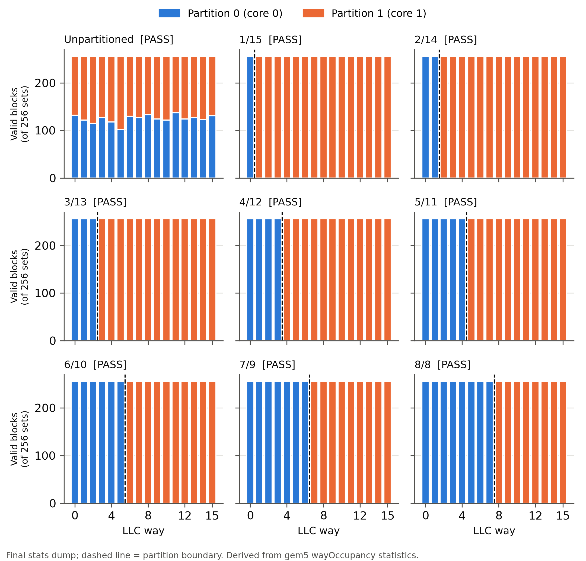
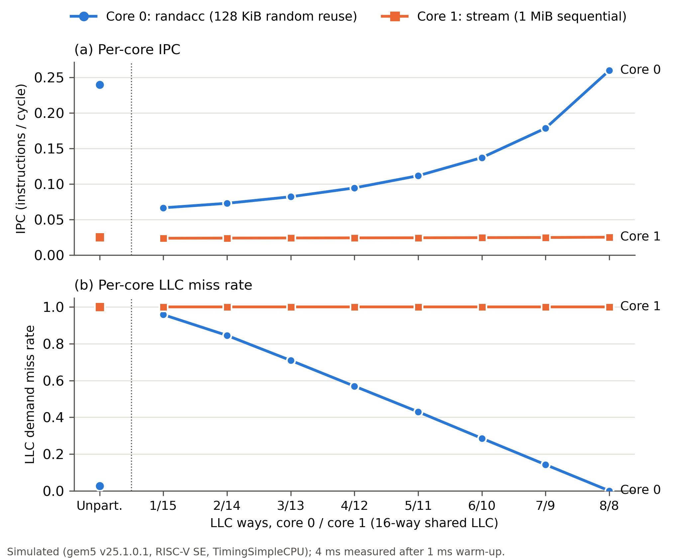
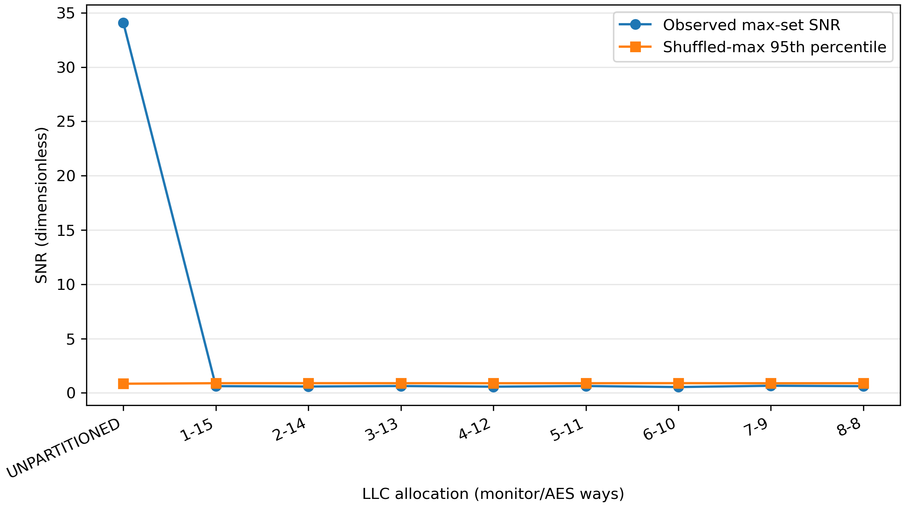
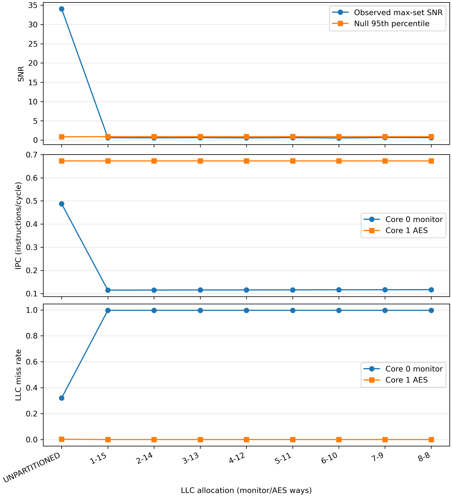

# LLC Way Partitioning and Simulated AES Cache Contention in gem5

> **Superseded contention conclusion (October 1, 2026):** the fixed-16-line
> partition sweep documented below is retained as a historical pilot, but its
> `1/15` collapse claim is invalid because the monitor self-thrashed when given
> fewer than 16 ways. The later single-seed correction was still non-monotonic.
> Use `REPORT_REPEATED_20261001.md` and
> `results/contention-repeated-20261001/` for the final three-seed,
> matched-control experiment. Capacity/isolation measurements elsewhere in
> this report remain separate historical evidence.

EEL 5764 Computer Architecture, Fall 2026, semester project (hardware security
track). Everything here is **simulated** in gem5; nothing ran on or was
measured from physical hardware.

## 1. Research question and scope

**As carried out:** in a two-core system with a 16-way shared last-level cache
(LLC), (a) does gem5's way partitioning actually confine each core to disjoint
LLC ways, (b) can a local monitor distinguish public active and idle intervals
of a deliberately leakage-prone T-table AES workload, and (c) how many ways
are needed before that measured activity signal is indistinguishable from a
corrected null, with what IPC and LLC miss-rate cost per core?

**Scope change and follow-up.** The original plan also measured whether a
cache-contention monitor on core 0 could tell apart active and idle intervals
of a T-table AES workload on core 1. That component was initially removed, then
implemented later as a simulator-only follow-up. Its first mandatory
unpartitioned functionality control, with 16 KiB L1D caches, failed the
predeclared shuffled-label criterion:
observed SNR 0.123071, null 95th percentile 0.502195, empirical p = 0.619938
(`results/contention/UNPARTITIONED/analysis.json`). A separately recorded
redesign used symmetric 4 KiB L1D caches and a multiplicity-corrected maximum
per-set statistic. That control passed: maximum SNR 34.075979 at set 1,
shuffled-maximum 95th percentile 0.842170, empirical p = 0.000100
(`results/contention-l1d4k/UNPARTITIONED/analysis.json`). As a result:

- **Measured:** both unpartitioned controls using 32 AES-active and 32
  AES-idle intervals, including the corrected shuffled-maximum null test.
- **Measured:** all eight partitioned contention configurations. Every split
  failed the corrected detectability criterion, so `1/15` is the first tested
  allocation at which the activity signal is indistinguishable from its null.
- **Main completed study:** direct per-way proof of isolation and the per-core
  performance cost of each split.

The measured claim is deliberately narrow: way partitioning makes this
monitor's activity statistic indistinguishable from the shuffled-label null
under the simulated configuration. It does not prove that every timing
channel through shared queues, ports, interconnects, or DRAM is removed.

## 2. Platform

| Item | Value |
|---|---|
| Simulator | gem5 `v25.1.0.1`, commit `c8222cc67a399bfc01e8658dd14b30d5bfd634f9`, `build/RISCV/gem5.opt` |
| Build host | WSL2 Ubuntu 26.04 on Windows 11, GCC 15.2.0 (gem5 officially supports GCC up to 14.2; the build finished with warnings only) |
| ISA / mode | RISC-V, syscall emulation (SE) |
| CPUs | 2 × `TimingSimpleCPU` at 2 GHz (in-order, blocking: one outstanding memory access per core) |
| L1 | Capacity study: private 16 KiB, 4-way L1I/L1D. Redesigned contention control: same L1I and symmetric 4 KiB, 4-way L1D. 1-cycle tag/data/response latency. |
| LLC | Shared, 256 KiB, **16-way**, 64 B lines (256 sets), LRU, 10-cycle tag/data/response latency, 32 MSHRs, `mostly_incl` clusivity, `writeback_clean=False` |
| Interconnect / memory | `L2XBar` (L1s to LLC), `SystemXBar` (LLC to memory), one `DDR3_1600_8x8` controller, 512 MiB |
| Window | 1 ms warm-up, stats reset, 4 ms measured, divided into 8 segments with a stats dump after each |

All tunables sit in the `CONFIG` dictionary in [configs/run.py](configs/run.py).
Each run's full configuration is saved as `results/<split>/config.ini` and
`run_meta.json`.

**Why SE mode:** it runs one static binary per core with no kernel or disk
image, so no OS scheduling or interrupt activity perturbs the caches. The
cost is that there is no real OS, page allocator or context switching (see §9).

**Why RISC-V:** `rdcycle` reads the CPU's cycle counter directly in user mode
(`src/arch/riscv/isa.cc:507`). That mattered for the original monitor design.
The RISC-V cross-compiler and its libc were also already installed.

## 3. Workloads

See [workloads/README.md](workloads/README.md) for full details.

- **Core 0, `randacc`:** uniform random 8-byte loads over a 128 KiB working
  set (2048 lines), with a fixed-seed LCG (seed 12345). 128 KiB is exactly 8
  LLC ways (8 × 256 sets × 64 B), the largest allocation core 0 receives.
- **Core 1, `stream`:** one load per line over a 1 MiB buffer, 4× the LLC.
  It never reuses a line within LLC capacity.

Both are freestanding: no libc, `-march=rv64gc`, no vector instructions.
While setting up I found a gem5 v25.1 bug: on `TimingSimpleCPU`, vector
fault-only-first loads raise a fault instead of trimming `vl` (the translation
fault goes through `TimingSimpleCPU::translationFault`, `src/cpu/simple/timing.cc:396`,
and bypasses the trimming code in `src/arch/riscv/isa/formats/vector_mem.isa`).
Ubuntu 26.04's static glibc uses such loads in `strrchr`, so any program
linked against it crashes during start-up. I avoided the problem rather than
patching gem5.

The separate contention experiment uses:

- **Core 0, `monitor_l1d4k`:** a simulator-only Prime+Probe-style monitor. It
  primes a 16-line pointer chain in each of 256 LLC sets, waits until the
  public interval's probe point, times re-access to its own lines with RISC-V
  `rdcycle`, and buffers one record per set per interval.
- **Core 1, `victim_l1d4k`:** an educational AES-128 implementation with four
  conventional 1 KiB T-tables, public fixed key
  `000102030405060708090a0b0c0d0e0f`, deterministic plaintext seed
  `0x5764a5e5`, and a fixed balanced schedule of 32 active and 32 idle
  intervals. A FIPS-197 known-answer test must pass before measurement.

Both contention cores use symmetric 4 KiB, four-way L1D caches so normal
capacity pressure—not an artificial eviction sweep—causes table activity to
reach the LLC. Each interval is two million CPU cycles, long enough to probe
all sets. The monitor reads only its own buffer and uses public labels; the
project performs no AES key recovery, byte ranking, or physical-hardware
measurement.

### How the workloads were chosen (disclosed in full)
Two pilots, archived under [results/pilot/](results/pilot/), preceded the sweep.

1. **Pilot 1** (`chase`, a fixed random pointer cycle, at 96/160/192/224 KiB).
   Under LRU a repeating cycle either all hits or all misses, so core 0's LLC
   miss rate was only ever 0 or 1. The pre-declared selection rule failed.
2. **Pilot 2** (`randacc` at 96/128/192 KiB, splits `off`, `1-15`, `4-12`,
   `8-8`). The rule was: pick the smallest working set with a ≥10% core-0 IPC
   difference both between `off` and `8-8` and between `1-15` and `8-8`. It
   failed at every size. The largest `off` vs `8-8` gap was 7.7%, at 128 KiB.
3. **128 KiB was chosen post hoc** because it spans the whole tested range,
   from 1 way (heavy thrashing) to 8 ways (exact fit), and gave the largest
   `off` vs `8-8` gap. This is a choice made after seeing pilot data, not a
   pre-registered one.

## 4. The LLC way-partitioning mechanism

**What stock gem5 provides.** `WayPartitioningPolicy`
(`src/mem/cache/tags/partitioning_policies/way_pp.cc`) removes from the list
of replacement candidates in `BaseSetAssoc::findVictim`
(`src/mem/cache/tags/base_set_assoc.hh:172-188`) every block whose way is not
allocated to the requesting partition. A partition can therefore **allocate
and evict only within its own ways**. Lookups are not filtered: a hit can be
served from any way.

**What stock gem5 is missing for this study.** The partition ID comes from
`PartitionManager::readPacketPartitionID()`, which returns `0` for every
packet. The only override is Arm MPAM (`src/dev/arm/mpam.cc:45`). On RISC-V
both cores would share partition 0 and the policy would isolate nothing.

**What I added.** [gem5_ext/](gem5_ext/) contains `RequestorPartitionManager`,
built out of tree with `EXTRAS=` so the gem5 source is unmodified. It maps
the requestors `cpu0.inst`/`cpu0.data` to partition 0 and
`cpu1.inst`/`cpu1.data` to partition 1. L1 writebacks arrive at the LLC with
the shared `wbRequestorId`, so they take the partition recorded for their
block address. Anything else counts as `unmappedLookups`. gem5's
`WayPartitioningPolicy` is used unchanged: for split `A-B`, partition 0 gets
ways `[0, A)` and partition 1 gets `[A, 16)`. The `off` control attaches the
same manager with no policy, so partition IDs are still recorded but nothing
is restricted.

**Instrumentation.** The manager adds these statistics:

| Statistic | Meaning |
|---|---|
| `wayOccupancy_p<P>::way<W>` | Valid LLC blocks of partition P in way W, recomputed from the tag array before every stats dump |
| `unmappedLookups` | Lookups that matched no requestor and no recorded block |
| `addrPartitionConflicts` | Lines used by both partitions (physically shared memory) |
| `requestorLookups`, `recordLookups` | How each lookup was resolved |

## 5. Validation

Criteria were fixed in [analysis/analyze.py](analysis/analyze.py) before the sweep.

- **Partitioned split `A-B` passes** only if all of these hold:
  - At **every** one of the 8 dumps, *violations* = (partition-0 blocks
    outside ways `[0,A)`) + (partition-1 blocks outside `[A,16)`) + (blocks
    with any other partition ID) = 0.
  - `unmappedLookups` = 0 and `addrPartitionConflicts` = 0.
  - Both partitions hold at least one block, so the check isn't vacuous.
- **The control passes** only if at least one way holds blocks from both
  partitions in the final dump, and the unmapped and conflict counters are 0.
- **The checker can fail.** Applied with 8-8's rules to the unpartitioned
  run, it reports 2,020–2,135 violating blocks at every dump.

**Results** (from `results/summary.csv`, columns `max_isolation_violations`,
`ways_holding_both_partitions`, `unmapped_lookups`,
`addr_partition_conflicts`, `validation`):

- **All eight partitioned splits pass.** Each has 0 violations across 8 dumps,
  0 unmapped lookups and 0 conflicts. See the occupancy figure.
- **The unpartitioned control passes.** All 16 ways hold blocks of both cores.
- **In `8-8`, the evidence rests mostly on core 1.** Core 1 made 151,032
  partition lookups in the measured window
  (`results/8-8/stats.txt`, `requestorLookups::1`), and at every dump its
  blocks occupied exactly ways 8–15 (256 each), while ways 0–7 held only core
  0's blocks. Core 0 made no LLC allocations in that window, because its
  working set fits exactly in its 8 ways.
- **Reproducibility.** Re-running `UNPARTITIONED` and `8-8` produced
  byte-identical `stats.txt` apart from the 40 host-timing lines. The
  validation copies are in `results/validation/`.



*Figure 1: valid LLC blocks per way, split by partition, at the final dump
(derived from `wayOccupancy`). Dashed line: partition boundary. PDF version:
[occupancy.pdf](results/figures/occupancy.pdf).*

## 6. Metric definitions

Capacity-study metrics are **simulated** values taken from the last
(cumulative) stats block of `results/<split>/stats.txt`. Contention-study
metrics use the first, explicitly measurement-only block in
`results/contention-l1d4k/<split>/stats.txt`.

- **IPC, core i** = `system.cpu<i>.ipc`.
- **LLC miss rate, core i** = (`system.llc.demandMisses::cpu<i>.inst` +
  `::cpu<i>.data`) / (`system.llc.demandAccesses::cpu<i>.inst` + `::cpu<i>.data`).
  gem5 omits zero-valued entries, so a missing entry counts as 0 only when
  `demandAccesses::total` is present. Zero accesses would give NaN; none
  occurred.
- **Changes vs. unpartitioned** are *derived*: the relative IPC change and
  the miss-rate difference in percentage points (pp), both computed from
  `summary.csv`.
- **Contention SNR** = `abs(mean(active) - mean(idle)) / pooled sample standard
  deviation`, evaluated independently for every LLC set. The reported
  statistic is the maximum set SNR. Each of 10,000 fixed-seed label shuffles
  recomputes the maximum across all nonconstant sets, so the 95th-percentile
  threshold corrects for searching 256 sets. A signal is distinguishable only
  if its observed maximum is above that threshold and empirical `p < 0.05`.

## 7. Results: security/performance trade-off



*Figure 2: per-core IPC (a) and LLC demand miss rate (b), with a shared
categorical x-axis. PDF version: [tradeoff.pdf](results/figures/tradeoff.pdf).*

Values from `results/summary.csv`; Δ is relative to the `UNPARTITIONED` row.

| Split (c0/c1) | IPC c0 | Δ IPC c0 | IPC c1 | Δ IPC c1 | LLC miss c0 | Δ (pp) | LLC miss c1 |
|---|---|---|---|---|---|---|---|
| UNPARTITIONED | 0.239680 | — | 0.025063 | — | 0.026675 | — | 1.000000 |
| 1/15 | 0.066524 | −72.2% | 0.023735 | −5.30% | 0.958203 | +93.2 | 1.000000 |
| 2/14 | 0.072875 | −69.6% | 0.023951 | −4.44% | 0.845253 | +81.9 | 1.000000 |
| 3/13 | 0.082067 | −65.8% | 0.024096 | −3.86% | 0.709193 | +68.3 | 1.000000 |
| 4/12 | 0.094526 | −60.6% | 0.024230 | −3.32% | 0.569160 | +54.2 | 1.000000 |
| 5/11 | 0.111641 | −53.4% | 0.024376 | −2.74% | 0.429698 | +40.3 | 1.000000 |
| 6/10 | 0.137096 | −42.8% | 0.024559 | −2.01% | 0.285322 | +25.9 | 1.000000 |
| 7/9 | 0.178503 | −25.5% | 0.024763 | −1.20% | 0.142148 | +11.5 | 1.000000 |
| 8/8 | 0.259680 | +8.3% | 0.025173 | +0.44% | 0.000000 | −2.7 | 1.000000 |

**Observations:**

1. **Core 0 bears almost all the cost.** Its LLC miss rate falls roughly
   linearly from 0.958 (1 way) to 0.000 (8 ways), and its IPC rises from
   0.0665 to 0.2597. Every split that gives it fewer than 8 ways is slower
   than sharing the LLC unpartitioned (−25.5% at 7/9, −72.2% at 1/15).
2. **`8/8` is the only split that beats the unpartitioned control on both
   cores:** +8.3% IPC for core 0 and +0.44% for core 1. Under plain LRU the
   stream's never-reused blocks are usually the oldest in their set and get
   evicted first, so sharing hurt core 0 only mildly (miss rate 0.0267).
   Partitioning removes that remaining interference.
3. **Core 1's LLC miss rate is 1.000000 in every configuration, yet its IPC
   still moves (0.023735–0.025173).** Its IPC tracks core 0's LLC misses:
   44,750 misses at 1/15 against 0 at 8/8 (`llc_misses_core0`). This is an
   *inference*, not a measurement. Because core 1's own LLC behaviour is
   constant, the most plausible explanation is contention in structures way
   partitioning does not isolate (the memory bus and DRAM; see §8). I did not
   run a solo baseline or attribute the effect to a specific structure.

### Contention-monitor sweep



*Figure 3: observed maximum per-set SNR and the 95th percentile of the
shuffled-maximum null. Values are derived from 32 public AES-active and 32
AES-idle intervals per configuration. PDF version:
[snr_vs_split.pdf](results/contention-l1d4k/snr_vs_split.pdf).*

| Split (monitor/AES) | Max-set SNR | Null 95th | Empirical p | Decision |
|---|---:|---:|---:|---|
| UNPARTITIONED | 34.075979 | 0.842170 | 0.000100 | distinguishable |
| 1/15 | 0.620168 | 0.890354 | 0.587841 | indistinguishable |
| 2/14 | 0.586151 | 0.894048 | 0.698730 | indistinguishable |
| 3/13 | 0.630672 | 0.891628 | 0.563944 | indistinguishable |
| 4/12 | 0.569734 | 0.889712 | 0.744926 | indistinguishable |
| 5/11 | 0.631600 | 0.889226 | 0.548445 | indistinguishable |
| 6/10 | 0.537381 | 0.895379 | 0.838616 | indistinguishable |
| 7/9 | 0.655326 | 0.885486 | 0.466553 | indistinguishable |
| 8/8 | 0.619269 | 0.890319 | 0.582442 | indistinguishable |

Values come from
[`results/contention-l1d4k/summary.csv`](results/contention-l1d4k/summary.csv).
Every directory contains 16,384 probe records and two gem5 statistics blocks.
All eight partitioned analyses report `PASS disjoint`, zero forbidden-way
blocks, zero unmapped lookups, and zero address-partition conflicts. At `8/8`,
the final measurement contains 2,048 monitor blocks in ways 0–7 and 126 AES
blocks in ways 8–15
(`results/contention-l1d4k/8-8/analysis.json`).

The **first tested allocation at which the signal is indistinguishable from
the null is `1/15`**. Relative to the unpartitioned contention control:

- Monitor IPC falls from 0.487557 to 0.114773, a **76.4596% cost**; its LLC
  miss rate rises from 0.320541 to 0.996678, **+67.6137 percentage points**.
- AES IPC falls from 0.672815 to 0.672674, a **0.0210% cost**; its LLC miss
  rate falls from 0.002522 to 0.00000762, **-0.2515 percentage points**.

The monitor walks 16 candidate lines per set. When it owns fewer than 16 LLC
ways, those lines contend with one another inside its partition, which
explains its near-one miss rate and large IPC cost. The AES core retains 15
ways at the collapse point and therefore pays almost no IPC cost.



*Figure 4: corrected SNR, per-core IPC, and per-core LLC miss rate for the
contention experiment. PDF version:
[contention_tradeoff.pdf](results/contention-l1d4k/contention_tradeoff.pdf).*

## 8. Shared structures outside the protection

Way partitioning here isolates **LLC data-way capacity only**. In this gem5
model these stay shared:

- **LLC request path.** The tag-lookup port and latency, MSHRs (32) and write
  buffers are common to both cores.
- **Interconnect.** The `L2XBar` between the L1s and the LLC, and the
  `SystemXBar` to memory, are arbitrated between cores. The coherent crossbar
  also carries snoop traffic; this classic-cache model has no directory.
- **Memory.** The DRAM controller's queues, banks and row buffers are shared.
  Observation 3 above is consistent with contention here.
- **Replacement and inclusion.** Hits are not filtered by partition, which is
  harmless here because the SE processes share no physical memory:
  `addrPartitionConflicts` = 0. `mostly_incl` does not back-invalidate L1
  copies when the LLC evicts, so the LLC is not strictly inclusive.

## 9. Threats to validity

- **Simulation vs. silicon.** gem5's classic caches and `TimingSimpleCPU` are
  abstractions. Real LLCs use hashed indexing, pseudo-LRU or adaptive
  replacement, prefetchers, and out-of-order cores with many outstanding
  misses. An in-order blocking core exaggerates how much IPC depends on miss
  rate.
- **Simplified workloads.** Two synthetic kernels, not real applications.
  `stream` is the extreme non-reusing case, so its cost is near zero by
  construction.
- **Post-hoc parameter choice.** Both pre-declared pilot rules failed. The
  128 KiB working set was chosen after seeing data (§3).
- **Deterministic inputs, single seed.** Runs are exactly reproducible, but
  there are no repeated trials, so no confidence intervals. The differences
  reported are deterministic simulator outcomes, not statistical estimates.
- **Timing fidelity.** Cache and DRAM latencies are gem5 defaults or my
  settings, not calibrated to any real part. The simulator was built with an
  unsupported compiler (GCC 15.2).
- **Finite run length.** The capacity study measures 4 ms after a 1 ms
  warm-up. Each redesigned contention run contains 64 two-million-cycle
  intervals (64 ms at 2 GHz) after the same 1 ms warm-up.
- **Untested path.** `recordLookups` = 0 in every run: no L1 writeback
  allocated in the LLC during measurement. The extension's writeback mapping
  is implemented but not exercised by these workloads.
- **Small LLC.** 256 KiB with 256 sets was chosen to keep runs short. Larger
  LLCs change the absolute numbers.
- **Residual shared structures** (§8) are not isolated and were not measured
  separately.
- **Signal attribution.** The redesigned monitor observes a large active/idle
  latency separation, but its accesses traverse shared LLC ports, queues,
  MSHRs, and interconnects. The sweep shows that disjoint data ways remove the
  measured statistic, but it cannot attribute the original unpartitioned
  signal exclusively to LLC data-way eviction.
- **One deterministic run per split.** The shuffled-label test characterizes
  interval-label separation within each deterministic simulation; it is not a
  confidence interval over repeated simulator runs or alternative plaintext
  seeds.

## 10. Limitations and inconclusive results

- The original 16 KiB unpartitioned contention control failed its predeclared
  null test. The redesigned 4 KiB method and full partition sweep are reported
  separately rather than reclassifying that failed pilot.
- Neither pilot met its pre-declared selection rule. The working-set choice
  is therefore a judgement call, disclosed in §3.
- The drop in core 1's IPC under small core-0 allocations is attributed to
  shared memory-side contention by inference only.

## 11. Reproducing

Run inside WSL2 Ubuntu 26.04:

```bash
# 1. gem5 v25.1.0.1 with the extension
cd ~/eel5764/gem5 && scons build/RISCV/gem5.opt -j14 EXTRAS=$HOME/eel5764/gem5_ext
# 2. workloads, sweep, analysis (from the project root)
sh workloads/build.sh
bash scripts/run_sweep.sh
python3 analysis/analyze.py --require-all
# 3. separate unpartitioned contention functionality control
bash scripts/run_contention_control.sh
python3 analysis/analyze_contention.py --results results/contention/UNPARTITIONED
# 4. redesigned unpartitioned control
bash scripts/run_contention_control.sh l1d4k
python3 analysis/analyze_contention.py \
  --results results/contention-l1d4k/UNPARTITIONED --statistic max-set
# 5. full redesigned contention sweep (from an empty result root)
bash scripts/run_contention_sweep.sh
python3 analysis/summarize_contention.py
```

`~/eel5764/gem5_ext` is a symlink to this project's `gem5_ext/`. Each
`results/<split>/` directory holds `cmd.txt` (the exact command),
`config.ini`/`config.json`, `run_meta.json`, `simout.txt` (the workload
headers), `stats.txt` and `workload_sha256.txt`.
