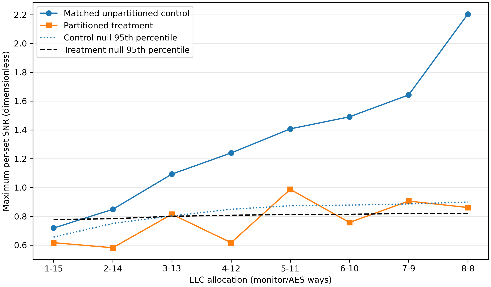
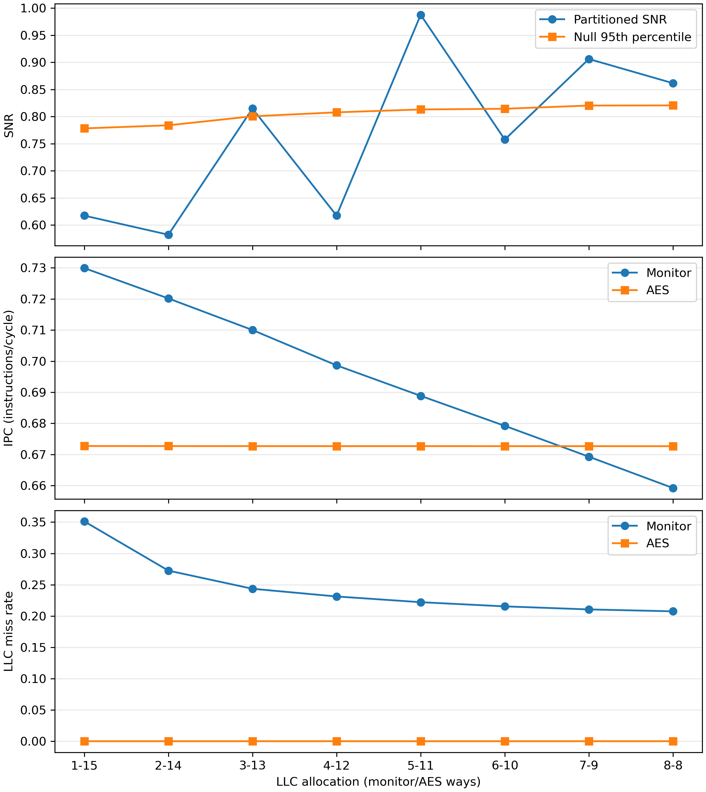

# Corrected Matched-Control AES Cache-Contention Study

## 1. Research question and status

This gem5-only study asks whether disjoint way partitioning of a shared
16-way LLC prevents a local monitor on core 0 from distinguishing public,
labelled AES-active and AES-idle intervals on core 1, and what IPC and LLC
miss-rate cost each allocation imposes.

The earlier fixed-16-line partition sweep is not used for this conclusion.
When the monitor owned only 1-8 ways, its 16-line cycle evicted itself and
produced an approximately 99.7% LLC miss rate. The corrected experiment primes
and probes exactly `A` lines per set for an `A/(16-A)` split and compares each
treatment with an unpartitioned control using the same depth `A`.

**Outcome:** all eight matched controls detected AES activity and all eight
partitions enforced disjoint LLC ways. Partitioned detectability was
non-monotonic, however. `1/15` was the first tested indistinguishable split,
but later splits regained significance, including `8/8`. Therefore this
single-run sweep does **not** establish a stable minimum number of ways.

## 2. Simulated platform

- gem5 v25.1.0.1, commit `c8222cc67a399bfc01e8658dd14b30d5bfd634f9`.
- RISC-V syscall-emulation mode; no physical hardware measurement.
- Two `TimingSimpleCPU` cores at 2 GHz.
- Private 16 KiB L1I and symmetric 4 KiB, four-way L1D caches.
- Shared 256 KiB, 16-way, 64-byte-line LLC with 256 sets and LRU replacement.
- One fresh gem5 process per configuration.
- Public AES-128 key, deterministic plaintext seed, and 32 active/32 idle
  intervals of 2,000,000 cycles each.

The 4 KiB L1D is a deliberate stress configuration: the four T-tables alone
occupy 4 KiB. It exposes lookup activity to the LLC but limits generalization
to processors with larger private caches.

## 3. Corrected monitor and validation gates

One monitor binary receives a required depth argument `A`. Its RISC-V entry
shim reads `argc/argv`, validates `1 <= A <= 16`, and walks exactly `A` lines
in each logical set. The partitioned configuration rejects any depth that does
not equal the monitor's assigned ways.

For every `A=1...8`:

1. Run unpartitioned with an A-line monitor.
2. Require its maximum per-set SNR to exceed its shuffled-maximum null with
   empirical `p < 0.05`.
3. Run `A/(16-A)` using the identical monitor and AES binaries.
4. Require zero out-of-partition LLC blocks.
5. Require a constant logical-to-physical LLC-set rotation for the monitor's
   `probe_lines` range.

Every saved case contains 16,384 probe records and two statistics blocks.
Across all 17 cases, workload hashes have exactly one unique value.

## 4. Statistic and decision rule

For each LLC set:

```text
SNR = abs(mean(active) - mean(idle)) / pooled sample standard deviation
```

The reported statistic is the maximum SNR over 256 sets. Each of 10,000 label
permutations recomputes that maximum, using fixed seed 5764. A signal is
`distinguishable` only when observed SNR exceeds the shuffled-max 95th
percentile and the corrected empirical p-value is below 0.05.

This null controls selection of the maximum set within one run. It does not
measure between-run variation or correct across the eight allocation tests.

## 5. Corrected results

| Split | Matched control SNR | Control p | Partitioned SNR | Partitioned null95 | Partitioned p | Result |
|---|---:|---:|---:|---:|---:|---|
| 1/15 | 0.718795 | 0.006299 | 0.617413 | 0.778167 | 0.217478 | indistinguishable |
| 2/14 | 0.848684 | 0.004400 | 0.582201 | 0.783886 | 0.564144 | indistinguishable |
| 3/13 | 1.093433 | 0.000300 | 0.814800 | 0.800486 | 0.021898 | distinguishable |
| 4/12 | 1.240161 | 0.000100 | 0.617413 | 0.807775 | 0.527347 | indistinguishable |
| 5/11 | 1.407379 | 0.000100 | 0.987548 | 0.813070 | 0.003900 | distinguishable |
| 6/10 | 1.490909 | 0.000100 | 0.757593 | 0.814364 | 0.136386 | indistinguishable |
| 7/9 | 1.642727 | 0.000100 | 0.906076 | 0.820311 | 0.015098 | distinguishable |
| 8/8 | 2.203389 | 0.000100 | 0.861482 | 0.820513 | 0.030597 | distinguishable |



The first tested indistinguishable allocation is `1/15`, but it is not a
collapse point: `3/13`, `5/11`, `7/9`, and `8/8` remain distinguishable.
Accordingly, the proposal's threshold question is inconclusive with one run
per split.

## 6. Performance at the first tested suppression

Relative to the matched A=1 unpartitioned control, `1/15` produced:

- Monitor IPC cost: `0.7879%`.
- AES IPC change: `+0.0042%` (a tiny increase, not a measured cost).
- Monitor LLC miss rate: `0.157511` to `0.351133`, an increase of
  `19.362274` percentage points.
- AES LLC miss rate: `0.00000889` to `0.00000762`, a decrease of
  `0.000127` percentage points.
- AES cycles/encryption: `2509.706` in both the matched control and treatment.

These IPC values remain secondary because both programs use `rdcycle`
busy-wait loops. AES cycles per completed encryption is the clearer useful-work
metric. With one deterministic run, the tiny AES differences should not be
interpreted as a general speedup.



## 7. Direct isolation and address-mapping evidence

All partitioned cases report:

- `isolation_validation = PASS disjoint`;
- `isolation_violations = 0`;
- `unmapped_lookups = 0`;
- `addr_partition_conflicts = 0`.

All 17 cases report `probe_mapping_validation = PASS congruent` and zero
logical-to-physical set-rotation mismatches. Thus the way-isolation and
address-congruence claims are supported independently of probe latency.

## 8. Proposal claim audit

| Proposal element | Status |
|---|---|
| gem5 version, RISC-V SE, two timing cores, cache hierarchy | Validated from configuration and run metadata |
| Public deterministic AES workload and labels | Validated; all AES self-tests passed |
| One fresh process per configuration | Validated by separate immutable result directories |
| Unpartitioned contention is observable | Validated for A=1...8 and the original A=16 control |
| Disjoint LLC ways are enforced | Validated directly with zero occupancy violations |
| Monitor addresses are LLC-set congruent | Validated directly with zero mapping mismatches |
| Every disjoint split removes the signal | Not validated; four treatments remain distinguishable |
| A minimum sufficient way count can be identified | Not validated; results are non-monotonic |
| IPC and LLC miss-rate costs are measured | Validated as simulated descriptive values; IPC is qualified because of busy-waiting |

## 9. Threats to validity

- gem5 timing is not silicon timing.
- The 4 KiB L1D is a stress configuration.
- Only one deterministic execution was run per case.
- The shuffled-label null measures within-trace association, not independent
  run-to-run uncertainty.
- MSHRs, queues, ports, interconnects, memory controllers, and DRAM remain
  shared. These are plausible explanations for residual activity signals.
- Testing eight allocation pairs introduces another level of multiplicity not
  covered by the per-run maximum-set null.
- IPC includes deliberate busy-wait instructions.

The next scientifically necessary step is repeated runs with several fixed
public seeds, followed by a predeclared across-allocation analysis. Until then,
the honest answer to "how many ways are sufficient?" is **inconclusive**.

## 10. Evidence paths

- `results/contention-corrected-20261001-v2/summary_matched.csv`
- `results/contention-corrected-20261001-v2/<case>/analysis.json`
- `results/contention-corrected-20261001-v2/<case>/stats.txt`
- `results/contention-corrected-20261001-v2/<case>/simout.txt`
- `results/contention-corrected-20261001-v2/matched_snr.pdf`
- `results/contention-corrected-20261001-v2/matched_tradeoff.pdf`

The stopped first instrumentation attempt remains preserved under
`results/contention-corrected-20261001/`; it was not used in this report.
